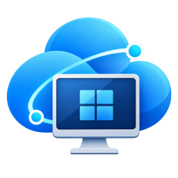

<p align="center">
  
</p>

<h1 align="center">Vindauga</h1>

<p align="center">
  A native Linux client for Azure Virtual Desktop and Windows 365.<br>
  Sign in once, pick your desktop, connect with one click.
</p>


<p align="center">
  <a href="https://github.com/ETroll/Vindauga/releases/latest">Download</a> ·
  <a href="#signing-in">Signing in</a> ·
  <a href="#building-from-source">Building from source</a>
</p>

---

*Vindauga* is the Old Norse word for window ("wind-eye"). The project is a C++20 / Qt 6 Quick application built on [FreeRDP 3](https://www.freerdp.com/), made for people who use Azure Virtual Desktop (AVD) or a Windows 365 Cloud PC from a Linux desktop and want something that simply works: no terminal, no hand-edited command lines, no browser tab pretending to be a desktop.

[](https://github.com/tcballard/omarchy-badges)

It is built and tested primarily on Wayland (Hyprland, KDE Plasma) and also runs on X11.

## Features

- **Your desktops, listed.** Sign in with your work account and Vindauga lists every desktop and app assigned to you, with icons, straight from Microsoft's feed. No `.rdp` file to download. The list is cached locally, so it is there the moment the app opens.
- **Sign in once.** The Entra ID (Azure AD) login, including MFA, happens in an embedded web view inside the app. Afterwards connections need no browser at all: the tokens the gateway and the desktop ask for are minted silently from a refresh token kept in your keyring. The sign-in page only reappears when your organisation's policy demands it, and then usually as a single click on your account.
- **Imported `.rdp` files still work.** If IT hands you a file, or your account has no feed access, import it as before.
- **Credentials stay in your keyring.** The refresh token and the username and password for the desktop sign-in are stored through the system keyring (GNOME Keyring, KWallet or any Secret Service provider), never in plain files.
- **Survives network hiccups.** A dropped connection is resumed automatically; the Windows session is picked up where it was, not logged on again.
- **Hardware video decoding.** H.264 streams from the session are decoded on the GPU through VA-API when available, with a device picker for hybrid-GPU laptops.
- **HiDPI aware.** Optionally tells Windows inside the session to scale to your display's real pixel density.
- **Dynamic resolution.** Resizing the window resizes the remote desktop.
- **Tunable smoothness.** A small, configurable frame buffer smooths bursts of screen updates at the cost of a few milliseconds of latency.

## Installation

Packages for each release are published on the [releases page](https://github.com/ETroll/Vindauga/releases/latest).

**Ubuntu 24.04 and derivatives** (Pop!_OS, Kubuntu, Linux Mint 22, KDE neon). The `.deb` bundles a recent Qt, because the Qt shipped by Ubuntu 24.04 is too old; it depends on the distribution's FreeRDP 3.

```bash
sudo apt install ./vindauga_<version>_amd64.deb
```

**Arch Linux** and derivatives:

```bash
sudo pacman -U vindauga-<version>-1-x86_64.pkg.tar.zst
```

Afterwards, "Vindauga" appears in your application menu.

## Signing in

1. Click **Sign in** and complete the Microsoft sign-in (password, MFA) in the window that opens.
2. Your desktops and apps appear as cards. Click one to connect.
3. The first time you connect to a desktop, Vindauga asks for the username and password the desktop itself wants (the "RDSTLS" step, unless your host pool uses Entra single sign-on). They are stored in your keyring.

That is all. Later starts sign in silently; the list is refreshed in the background. If your organisation's policy requires a fresh sign-in (typically every few days or weeks), a message says so and the **Sign in** button is back; thanks to the kept browser session that is usually one click.

**Using an .rdp file instead.** Click **Import .rdp…** and select the file. Microsoft's web client at <https://windows.cloud.microsoft> provides one under **Settings → Resources launch method → Download the RDP file**; any file that works with Microsoft's Windows App works here too.

This has been tested with Azure Virtual Desktop host pools. Windows 365 uses the same feed and file format but has not been verified.

## Usage notes

- **Settings** (gear icon) lets you toggle HiDPI scaling, hardware decoding and the GPU device, set the frame buffer length, keep the session awake (synthetic mouse motion while idle, off by default), and, for tenants that need it, set the feed discovery URL (sovereign clouds) or the browser identity the sign-in presents (Conditional Access device-platform rules).
- **Sign-in trouble?** The message under the header explains the Entra error in plain words and carries the `AADSTS` code for your IT department. `docs/feed-discovery.md` describes the whole flow.
- **Logs** are written to `~/.local/state/vindauga/vindauga.log`. Start the app from a terminal with `vindauga --log-terminal --log-level=debug` to see them live. Secrets are never logged.
- **Keyboard layout on X11.** If your X server advertises a keyboard variant that does not exist in the installed xkeyboard-config (for example `no(win)` instead of `no(winkeys)`), the embedded browser used for sign-in would crash. Vindauga detects this at startup, repairs the advertised layout and logs a warning telling you how to fix your system configuration permanently.

## Building from source

Requirements: CMake 3.21+, Ninja, a C++20 compiler, Qt 6.9 or newer (Core, Network, Quick, QuickControls2, WebEngineQuick, ShaderTools), FreeRDP 3 development files, QtKeychain for Qt 6, libxkbcommon and libxcb development files.

**Arch Linux**

```bash
sudo pacman -S --needed cmake ninja qt6-base qt6-declarative qt6-webengine qt6-shadertools qtkeychain-qt6 freerdp
cmake --preset debug
cmake --build --preset debug
ctest --preset debug
```

**Ubuntu 24.04**

Ubuntu's Qt is older than 6.9, so install Qt with [aqtinstall](https://github.com/miurahr/aqtinstall) and point CMake at it. QtKeychain must then be built against that Qt as well.

```bash
sudo apt install cmake ninja-build pkg-config freerdp3-dev libgl1-mesa-dev libxkbcommon-dev libxcb1-dev libsecret-1-dev
pip install --user aqtinstall
aqt install-qt linux desktop 6.9.1 linux_gcc_64 -m qtwebengine qtwebchannel qtpositioning qtshadertools -O ~/Qt

git clone --branch v0.14.0 --depth 1 https://github.com/frankosterfeld/qtkeychain.git ~/src/qtkeychain
cmake -S ~/src/qtkeychain -B ~/src/qtkeychain/build -G Ninja -DCMAKE_BUILD_TYPE=Release \
  -DCMAKE_PREFIX_PATH=$HOME/Qt/6.9.1/gcc_64 -DCMAKE_INSTALL_PREFIX=$HOME/qtkeychain-qt6 \
  -DBUILD_WITH_QT6=ON -DBUILD_TRANSLATIONS=OFF -DLIBSECRET_SUPPORT=ON
cmake --build ~/src/qtkeychain/build && cmake --install ~/src/qtkeychain/build

export CMAKE_PREFIX_PATH="$HOME/Qt/6.9.1/gcc_64:$HOME/qtkeychain-qt6"   # colon-separated
cmake --preset debug
cmake --build --preset debug
ctest --preset debug
```

The packaging scripts under `packaging/` (`build-deb.sh`, `PKGBUILD`) are what the release workflow runs and double as a reference for a complete build.

## How it works, briefly

The RDP session itself is standard RDP over Microsoft's Azure gateway, driven by libfreerdp. Everything around it is Qt: the Quick UI, the embedded WebEngine view that hosts the Entra ID sign-in, and QtKeychain for credential storage. Sign-in is OAuth authorization code + PKCE against Microsoft's public Remote Desktop client ID; the resulting refresh token mints the feed token and, at connect time, the gateway and session-host tokens FreeRDP asks for, so no browser is involved after the first sign-in. See `docs/feed-discovery.md`. Frames are uploaded to a persistent GPU texture in the Qt scene graph, so only the regions that changed are re-uploaded.

Layering: `src/core` (session, auth, storage; uses QtGui for `QImage` but nothing from Qt Quick), `src/ui` (Qt Quick UI and backends), `src/app` (the executable). Tests live in `tests/`.

## License

Vindauga is released under the [MIT License](LICENSE). It links against Qt (LGPL 3) and FreeRDP (Apache 2.0); the `.deb` package bundles Qt as shared libraries, which you may replace with your own build.
